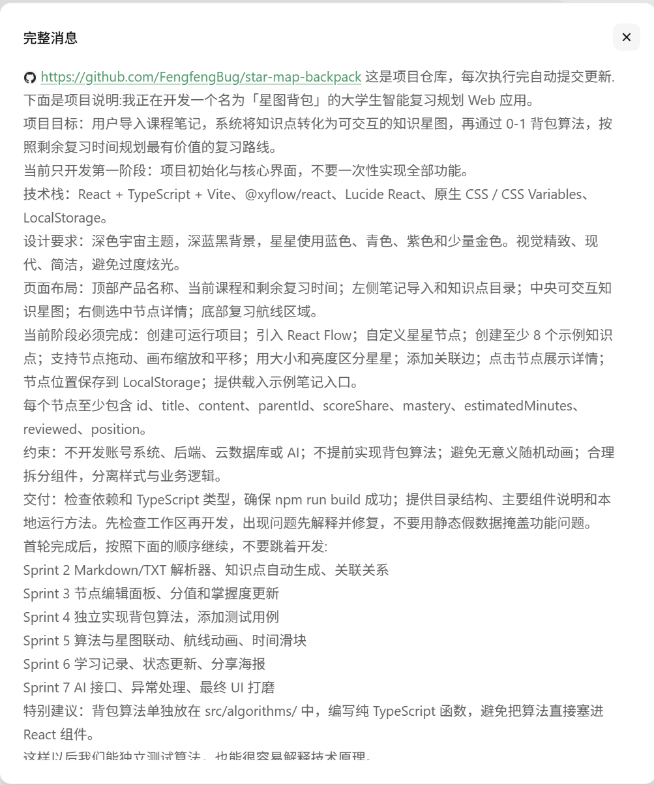
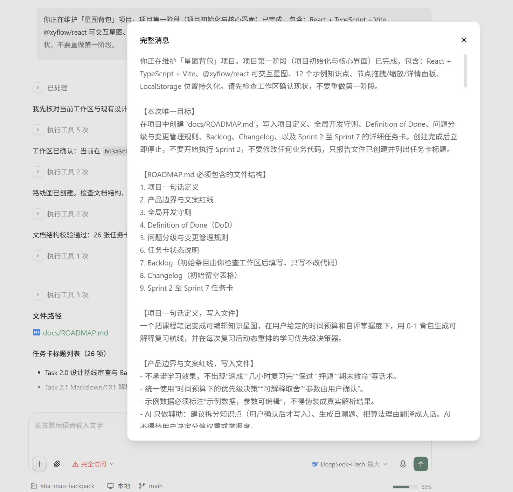
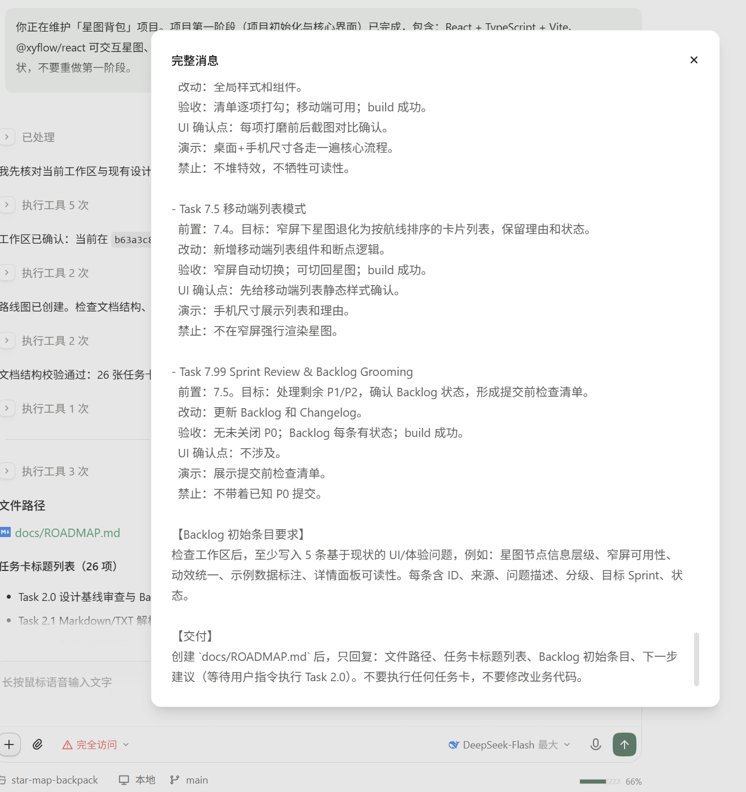
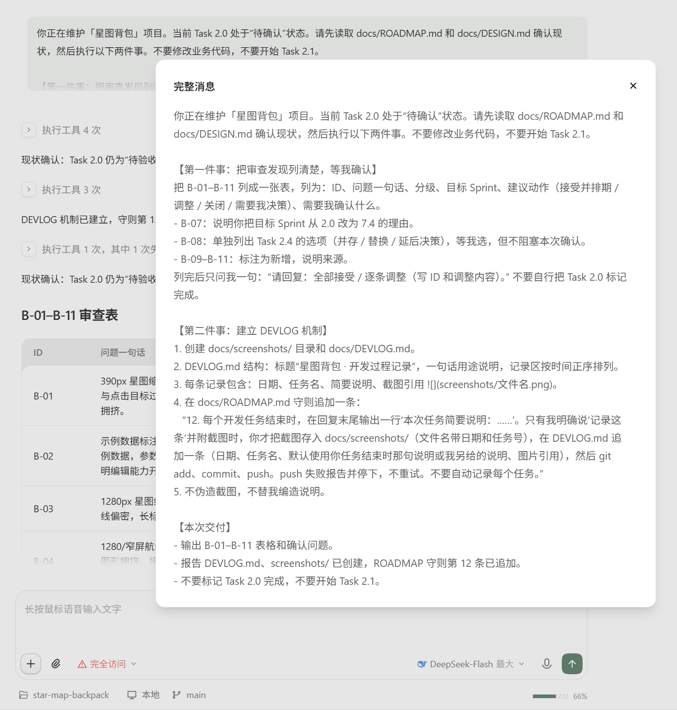
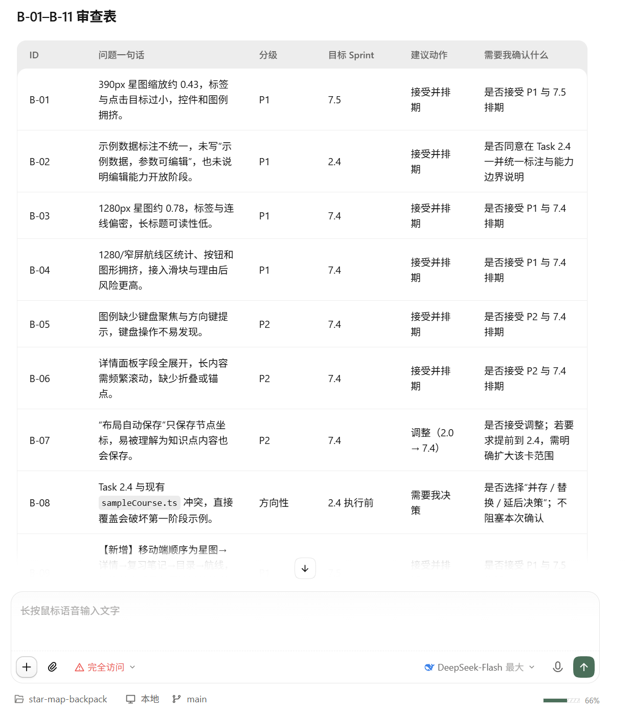
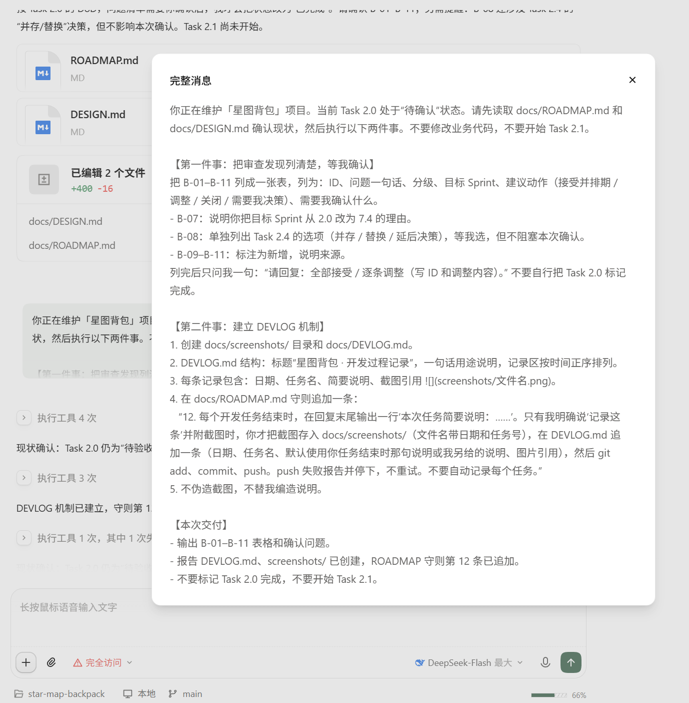

# 星图背包 · 开发过程记录

用于按时间正序记录经用户明确确认并附截图的开发任务，保留任务说明与界面证据。

## 记录

### 2026-11-07 · 第一阶段：项目初始化与核心界面

简要说明：搭建 React + TypeScript + Vite 项目，接入 React Flow；完成深空主题、12 个示例知识点、4 个章节、9 条关联边、自定义星体节点与星座边、拖拽/缩放/平移、节点详情联动、LocalStorage 位置持久化、载入示例与响应式布局；修复拖拽持久化、选中同步、示例重置和标签可读性问题；`npm run build` 通过并推送 `b63a3c8`。

### 2026-11-08 · 路线图与 Sprint 2–7 任务卡

简要说明：创建 `docs/ROADMAP.md`，包含项目定义、产品边界与文案红线、全局开发守则、DoD、问题分级与变更管理、任务状态说明、B-01–B-08 初始 Backlog、空 Changelog，以及 Sprint 2–7 共 26 张任务卡；提交 `d10e5b7` 并推送。

### 2026-11-08 · Task 2.0 设计基线审查与验收

简要说明：审查现有 UI 与设计 token，创建 `docs/DESIGN.md`，覆盖颜色、字体、间距、圆角、阴影、动效、数据可视化编码、可访问性与文案边界；Backlog 复核为 B-01–B-11，新增 B-09–B-11 并调整 B-07 目标；用户确认全部审查条目后，Task 2.0 标记完成；提交 `4cda2b7`，验收收口提交 `af3d698`。

### 2026-11-08 · DEVLOG 机制建立

简要说明：创建 `docs/DEVLOG.md` 与 `docs/screenshots/`，在 Roadmap 追加守则第 12 条；仅建立机制，截图记录由本次补录完成；提交 `c9dd17c`，当时推送失败后停止，本次补录随文档修改一并提交。

