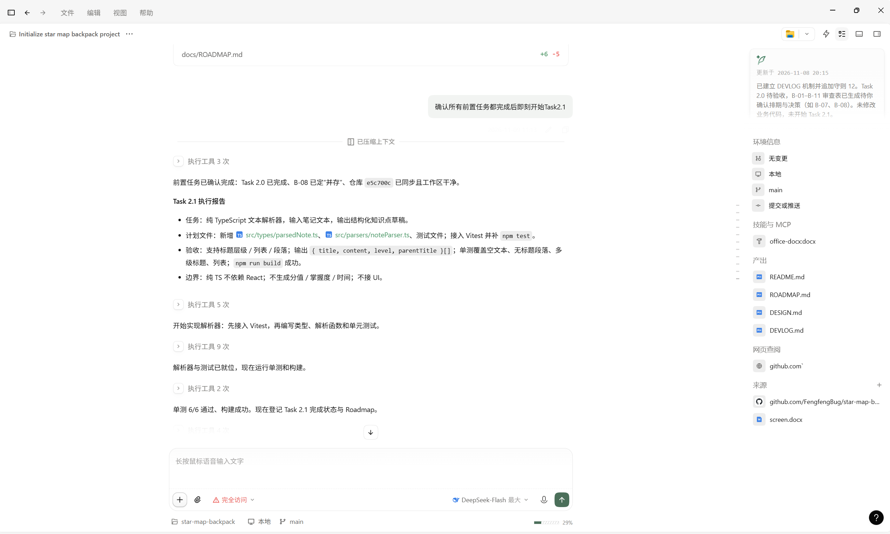
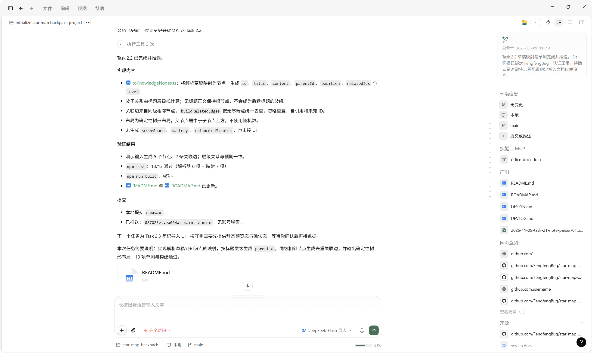
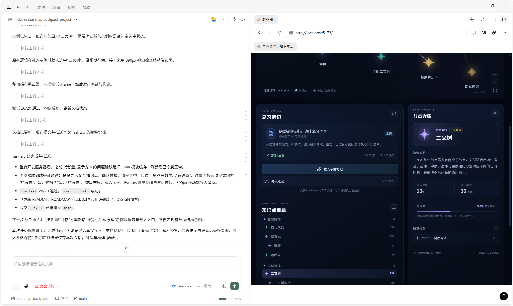
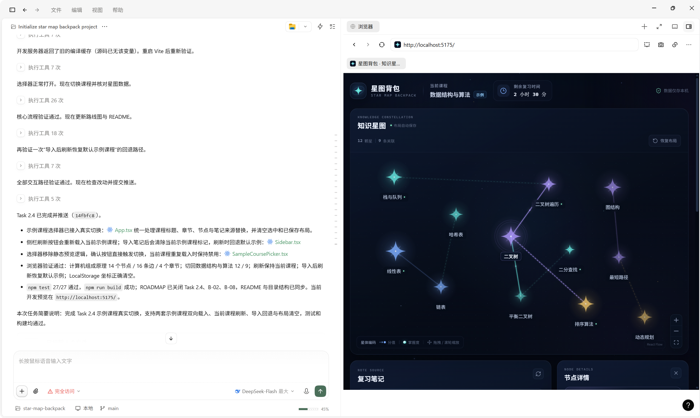
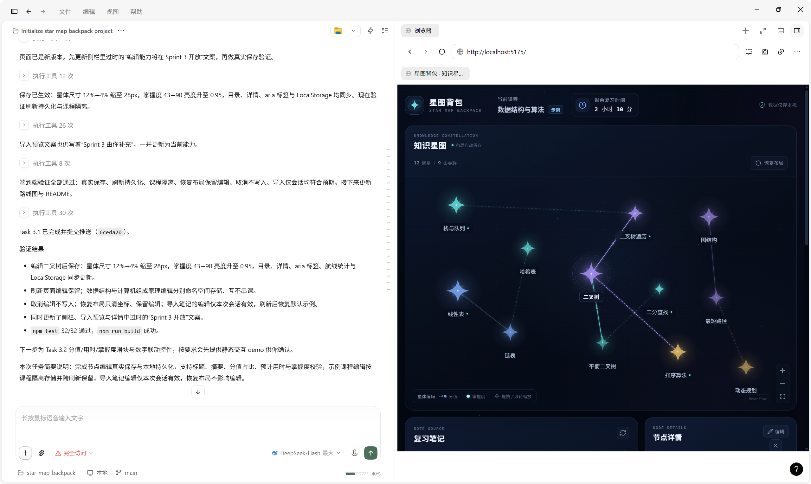
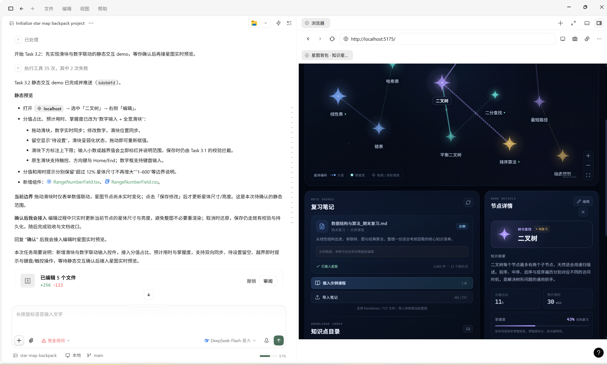
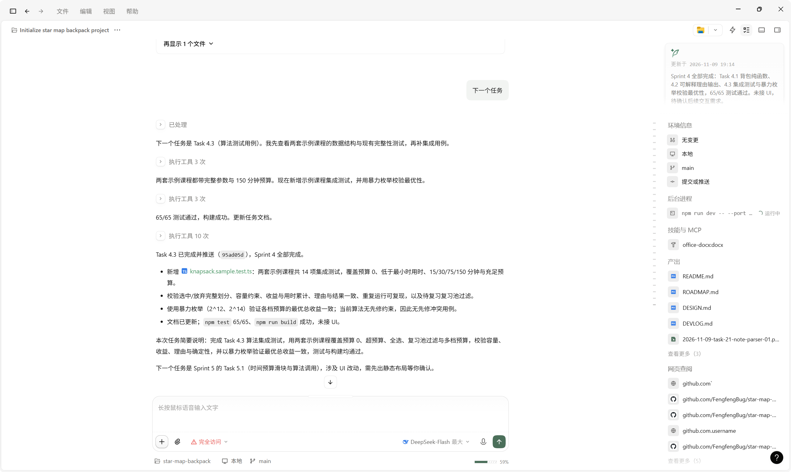
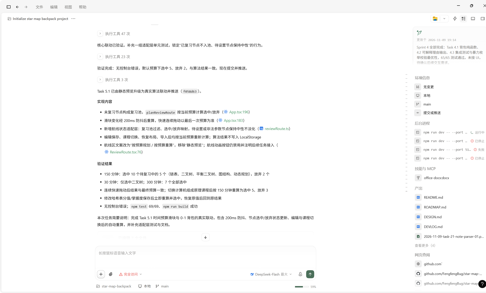

# 星图背包 · 开发过程记录

用于按时间正序记录经用户明确确认并附截图的开发任务，保留任务说明与界面证据。

## 记录

### 2026-11-07 · 第一阶段：项目初始化与核心界面

简要说明：搭建 React + TypeScript + Vite 项目，接入 React Flow；完成深空主题、12 个示例知识点、4 个章节、9 条关联边、自定义星体节点与星座边、拖拽/缩放/平移、节点详情联动、LocalStorage 位置持久化、载入示例与响应式布局；修复拖拽持久化、选中同步、示例重置和标签可读性问题；`npm run build` 通过并推送 `b63a3c8`。

### 2026-11-08 · 路线图与 Sprint 2–7 任务卡

简要说明：创建 `docs/ROADMAP.md`，包含项目定义、产品边界与文案红线、全局开发守则、DoD、问题分级与变更管理、任务状态说明、B-01–B-08 初始 Backlog、空 Changelog，以及 Sprint 2–7 共 26 张任务卡；提交 `d10e5b7` 并推送。

### 2026-11-08 · Task 2.0 设计基线审查与验收

简要说明：审查现有 UI 与设计 token，创建 `docs/DESIGN.md`，覆盖颜色、字体、间距、圆角、阴影、动效、数据可视化编码、可访问性与文案边界；Backlog 复核为 B-01–B-11，新增 B-09–B-11 并调整 B-07 目标；用户确认全部审查条目后，Task 2.0 标记完成；提交 `4cda2b7`，验收收口提交 `af3d698`。

### 2026-11-08 · DEVLOG 机制建立

简要说明：创建 `docs/DEVLOG.md` 与 `docs/screenshots/`，在 Roadmap 追加守则第 12 条；仅建立机制，截图记录由本次补录完成；提交 `c9dd17c`，当时推送失败后停止，本次补录随文档修改一并提交。

### 2026-11-09 · Task 2.1 Markdown/TXT 解析器核心

简要说明：实现 Markdown/TXT 解析器核心与 Vitest 单元测试，支持标题层级、列表、段落和无标题正文，未接 UI、未生成分值或掌握度。

### 2026-11-09 · Task 2.2 解析草稿到节点映射

简要说明：实现解析草稿到知识点的映射，按标题层级生成 `parentId`，同级相邻节点生成去重关联边，并输出确定性树形布局；13 项单测与构建通过。

### 2026-11-09 · Task 2.3 笔记导入真实接入

简要说明：完成 Task 2.3 笔记导入真实接入，支持粘贴/上传 Markdown/TXT、解析预览、错误提示与确认后替换星图，导入参数保持“待设置”且结果仅存本次会话，测试与构建均通过。

### 2026-11-09 · Task 2.4 示例课程数据包与真实切换

简要说明：完成 Task 2.4 示例课程数据包与真实切换，新增计算机组成原理 14 个知识点与 4 个章节，与数据结构示例通过注册表并存；选择器确认后替换课程标题、章节、节点与笔记来源，清空选中与已保存坐标，刷新按钮重载当前示例课程，导入后回退默认示例；测试与构建均通过。

### 2026-11-09 · Task 3.1 节点编辑与本地持久化

简要说明：完成 Task 3.1 节点编辑真实保存与本地持久化，详情面板支持编辑标题、摘要、分值占比、预计用时与掌握度，保存后星图尺寸/亮度、目录、详情与航线统计同步更新；示例课程编辑按 `sample:<courseId>` 存入 LocalStorage 并跨刷新、跨课程隔离保留，导入笔记的编辑仅本次会话有效，恢复布局只清坐标、保留编辑；新增 5 条存储测试，`npm test` 32/32、`npm run build` 成功。

### 2026-11-09 · Task 3.2 滑块与数字联动控件与实时预览

简要说明：完成 Task 3.2 滑块与数字联动控件及编辑时星图实时预览，分值占比、预计用时与掌握度支持双向同步、待设置留空、越界即时提示与保存拦截；编辑数值时当前星体尺寸/亮度实时预览，其余节点不跟随重渲染，取消或切换节点自动还原，保存仍复用既有校验与持久化，`npm test` 32/32、`npm run build` 成功。

### 2026-11-09 · Task 4.3 算法测试用例

简要说明：完成 Task 4.3 算法集成测试，用两套示例课程覆盖预算 0、超预算、全选、复习池过滤与多档预算，校验容量、收益、理由与确定性，并以暴力枚举验证最优总收益一致，测试与构建均通过。

### 2026-11-09 · Task 5.1 时间预算与 0-1 背包联动

简要说明：完成 Task 5.1 时间预算滑块与 0-1 背包真实联动，未复习节点构成复习池，预算变化经 200ms 防抖后重算；选中节点显示金色航线点、放弃节点淡化，待设置/非法参数节点保持中性；编辑保存、课程切换、恢复布局与导入后均按当前预算重新计算，算法结果不写入 LocalStorage；新增航线状态映射与 4 项测试，`npm test` 69/69、`npm run build` 成功。

